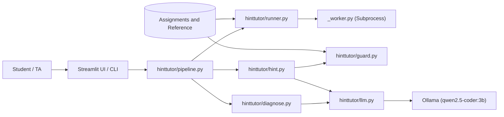
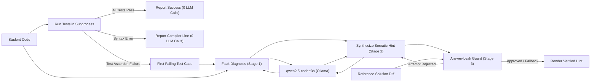
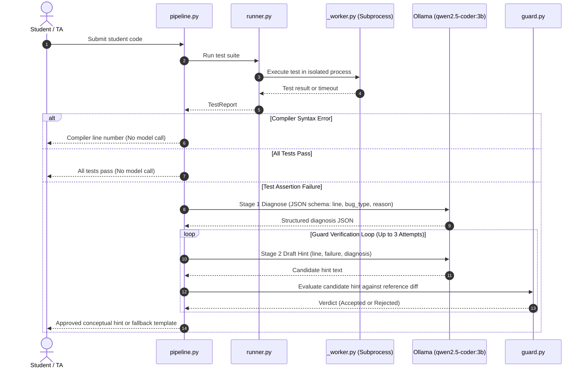

# Hint Tutor

> **Test-grounded, leak-guarded AI programming tutor for Python assignments powered by local, open-weight models.**

Hint Tutor helps Teaching Assistants and students in introductory computer science courses debug failing code without short-circuiting the learning process. Instead of hallucinating bugs or leaking direct copy-paste solutions, Hint Tutor relies on deterministic test cases to establish ground truth, uses an isolated subprocess runner to detect the exact failing assertion, and tasks a local 3B parameter model with diagnosing the fault and generating a Socratic hint. Every hint must pass through a strict AST- and diff-based **Answer-Leak Guard** before reaching the student.

---

## Project Overview

* **Target User:** Teaching Assistants (grading/office hours) and beginner students in introductory Python programming courses.
* **The Problem:** Instructors managing hundreds of lab submissions cannot write personalized hints for every broken submission. Conversely, unconstrained commercial LLMs (e.g., ChatGPT) either hallucinate nonexistent syntax issues or bypass learning entirely by outputting complete replacement code.
* **The Solution:** A dual-stage verification harness. Unit tests determine pass/fail truth deterministically; the AI model is invoked solely to explain *why* the verified failure occurred. A diff-based leak guard blocks code fences, verbatim lines, and added token deltas from the reference solution.
* **Core Features:**
  * **Zero-Cloud Privacy & Offline Execution:** Runs 100% locally on consumer hardware via Ollama. No student code or course materials leave the local machine.
  * **Isolated Process Execution:** Executes untrusted student code in isolated subprocesses (`python -I`) with strict per-test timeouts to terminate infinite loops and recursion faults.
  * **Two-Stage Prompt Pipeline:** Stage 1 performs structured fault localization (line number and bug type via JSON schema); Stage 2 drafts a pedagogical hint ending in a guiding question.
  * **Answer-Leak Guard:** Diffs student code against canonical reference code and rejects hints containing code fences, normalized fix lines, or changed fix expressions.
  * **Deterministic Safe Fallback:** If the model fails the guard across three attempts, the harness automatically falls back to a deterministic, leak-free tracing prompt.
  * **Dual Interface:** Streamlit interactive web dashboard with an instructor "Under the Hood" audit view, alongside a lightweight CLI for terminal workflows and automated batch evaluations.

---

## AI Component Disclosure

| Specification | Implementation Detail |
|---|---|
| **Model Name** | `qwen2.5-coder:3b` (`Qwen2.5-Coder-3B-Instruct`) |
| **Parameter Size** | **3.09 Billion parameters** (Strictly within the <= 8B hackathon limit) |
| **Runtime & Provider** | Local [Ollama](https://ollama.com/) instance via the official Ollama Python SDK (`localhost:11434`) |
| **Context Window** | `num_ctx: 4096` explicitly enforced per request |
| **Temperature Profile** | `0.0` for Stage 1 Fault Localization (deterministic JSON); `0.3` for Stage 2 Socratic Hint Generation |
| **Integration Role** | Core reasoning engine. Without the model, the harness can only report test passes or assertion failures; the model provides semantic fault localization and pedagogical explanation. |

---

## Architecture & System Design

### 1. System Architecture


### 2. Data Flow Diagram (DFD)


### 3. Execution Sequence & Guard Retry Loop


---

## How It Works

1. **Pre-execution Linting:** The pipeline compiles the submitted string via Python's built-in `compile()` AST pass. If a `SyntaxError` exists, execution aborts immediately, returning the compiler line number and advice without consuming LLM cycles.
2. **Subprocess Isolation:** `runner.py` spawns an isolated Python interpreter (`python -I _worker.py`) for each test case over standard I/O. Any student-inserted `print()` statements are redirected to an internal buffer so JSON payloads remain uncorrupted. Tests enforce an initial 5.0-second timeout; if an infinite loop occurs, subsequent tests automatically fast-abort to eliminate blocking freezes while preserving the complete test report.
3. **Stage 1 — Fault Localization (`diagnose.py`):** The failing input, expected return value, actual output (or error traceback), and numbered source code are sent to `qwen2.5-coder:3b`. Using Ollama's structured schema mode, the model must return a JSON object adhering to:
   ```json
   {
     "line": 3,
     "bug_type": "off_by_one",
     "reason": "The range excludes n because range stop values are non-inclusive."
   }
   ```
4. **Stage 2 — Socratic Hint Drafting (`hint.py`):** The model is instructed to write a 2- to 3-sentence hint pointing the student toward the diagnosed line and ending with a reflective question. It is explicitly instructed never to emit code blocks or reveal replacement expressions.
5. **Stage 3 — Answer-Leak Guard (`guard.py`):** Before display, candidate hints are analyzed against the assignment's `reference.py` using normalized AST line diffing:
   * **Rule 1 (Code Fences & Executable Statements):** Hints containing triple backticks (`` ``` ``) or executable statements (`def `, `return `, `for `, `while `) are immediately rejected.
   * **Rule 2 (Verbatim Normalized Lines):** Any hint containing a normalized line from the reference fix (whitespace and punctuation squashed) is rejected.
   * **Rule 3 (Changed Fix Expression):** Diffs under 5 lines extract added token clusters (e.g., `n + 1`, `<=`, `- discount`). If these specific token sequences appear in the text, the hint is rejected.
6. **Self-Correction & Fallback:** When a hint is rejected, the harness issues a retry prompt with generic rule reasons (without leaking the fix text into the prompt context). If all 3 attempts fail, the harness serves a guaranteed leak-free template:
   > *"Look at line N. Trace the failing input by hand and compare each step to what you expect."*

---

## Repository Structure

```text
hint-tutor/
├── README.md                          # Comprehensive project documentation & findings
├── LICENSE                            # MIT open-source license
├── requirements.txt                   # Minimal dependencies (ollama, streamlit)
├── .gitignore                         # Python, venv, and IDE exclusion patterns
│
├── app.py                             # Streamlit frontend with TA under-the-hood inspection view
├── cli.py                             # Terminal interface (supports --debug and --json output)
│
├── hinttutor/                         # Pure Python core package (no UI dependencies)
│   ├── __init__.py                    # Version metadata
│   ├── assignment.py                  # Dataclasses and JSON/Python assignment loaders
│   ├── config.py                      # Central settings, environment overrides, timeouts
│   ├── diagnose.py                    # Stage 1: Fault localization & structured JSON validation
│   ├── guard.py                       # Stage 3: Diff-based AST/token leak verification
│   ├── hint.py                        # Stage 2: Socratic generation, retry loop & fallback
│   ├── llm.py                         # Ollama client wrapper with call-level telemetry
│   ├── models.py                      # Shared type-annotated dataclasses
│   ├── pipeline.py                    # End-to-end orchestration pipeline
│   ├── prompts.py                     # System and user prompt templates
│   ├── runner.py                      # Subprocess test orchestration
│   └── _worker.py                     # Isolated child process test executor
│
├── assignments/                       # 8 Standard benchmark assignments
│   ├── count_evens/                   # List iteration and modulo filtering
│   ├── count_vowels/                  # String normalization and membership testing
│   ├── factorial/                     # Recursion and base-case termination
│   ├── fibonacci/                     # State tuple updates and iteration bounds
│   ├── is_palindrome/                 # Two-pointer string comparison
│   ├── max_of_list/                   # Accumulator tracking and index boundaries
│   ├── remove_negatives/              # Non-mutating list filtering
│   └── sum_to_n/                      # Arithmetic loop bounds
│
├── eval/                              # Evaluation and benchmarking harness
│   ├── __init__.py
│   ├── mutate.py                      # AST mutation generator (swaps comparison, binops, constants)
│   ├── run_eval.py                    # Batch pipeline evaluation producing results.csv
│   ├── handwritten/manifest.json      # 8 Hand-crafted logic and mutation bug archetypes
│   └── cases/manifest.json            # 42 Verified failing AST mutant programs
│
└── docs/
    └── architecture.md                # Standalone architectural documentation and diagrams
```

---

## Setup & Installation

### Prerequisites
* **Python 3.11+** installed.
* **[Ollama](https://ollama.com/)** (v0.5.0 or newer for structured JSON output).

### 1. Clone & Setup Virtual Environment
```bash
git clone https://github.com/Abdurrafay19/hint-tutor.git
cd hint-tutor

# Create and activate virtual environment
python -m venv .venv

# On Windows:
.venv\Scripts\activate

# On Linux / macOS:
source .venv/bin/activate

# Install required dependencies
pip install -r requirements.txt
```

### 2. Prepare Local Model
Ensure Ollama is running in the background, then pull the 3B parameter model:
```bash
ollama pull qwen2.5-coder:3b
```

### 3. Optional Environment Configuration
You can customize runtime behavior by exporting environment variables:
* `HINTTUTOR_MODEL`: Override model identifier (Default: `qwen2.5-coder:3b`).
* `HINTTUTOR_NUM_CTX`: Context window token limit (Default: `4096`).
* `HINTTUTOR_KEEP_ALIVE`: Model RAM persistence window (Default: `30m`).

---

## Usage

### Web Interface (Streamlit)
Launch the interactive visual dashboard:
```bash
streamlit run app.py
```
* Navigate to `http://localhost:8501`.
* Select an assignment from the sidebar.
* Edit student code in real time and trigger tests.
* Toggle the **TA View (Under the Hood)** checkbox to inspect Stage 1 diagnosis JSON, call latency, exact prompt strings, and the Answer-Leak Guard attempt audit trail.

### Command-Line Interface (CLI)
Run individual student scripts directly from your terminal:
```bash
# List all available assignments
python cli.py --list

# Test a student file with standard output
python cli.py sum_to_n assignments/sum_to_n/buggy.py

# Run with full TA debugging telemetry
python cli.py sum_to_n assignments/sum_to_n/buggy.py --debug

# Export machine-readable pipeline output
python cli.py sum_to_n assignments/sum_to_n/buggy.py --json
```

---

## Testing & Findings

### Automated Unit Test Suite
The core framework includes 29 unit tests covering subprocess execution, tuple preservation, timeout fast-abort, AST normalization, diff candidate extraction, guard rejection rules (code fences, executable statements, colon normalization), and pipeline exception handling with mock LLM calls (runs in <2 seconds without Ollama):
```bash
python -m unittest discover -s tests -t .
```

### Empirical Model Evaluation
The evaluation suite benchmarks `qwen2.5-coder:3b` against a 50-case benchmark comprising **42 verified failing AST mutants** (comparison swaps, binary operator substitutions, constant boundary shifts) and **8 hand-crafted structural bugs** (missing recursive base cases, in-place list mutations, case normalization omissions).

To run the complete evaluation:
```bash
# Generate mutant variants (already pre-generated in eval/cases/)
python -m eval.mutate --per-assignment 6

# Execute full evaluation across all cases
python -m eval.run_eval
```

### Benchmark Evaluation Metrics

Below are the empirical findings recorded on a local consumer laptop (AMD Ryzen 5 5600H CPU, 16 GB RAM, local Ollama runtime):

| Metric | Measured Value | Benchmark Description |
|---|---|---|
| **Total Evaluated Cases** | **50** | 42 AST mutants across 7 assignments + 8 hand-crafted structural bugs |
| **Exact Line Diagnosis** | **60.0%** (30/50) | Model accurately localized the exact mutated or faulty line |
| **Line Within +-1 Tolerance** | **74.0%** (37/50) | Model localized within 1 line of ground truth (capturing multi-line loop/if blocks) |
| **Bug Type Match** | **42.0%** (21/50) | Exact categorical match against ground-truth bug taxonomy |
| **First-Attempt Guard Rejection Rate** | **36.0%** (18/50) | Stricter guard caught initial hints attempting to leak code blocks, statements, or fix tokens |
| **Fallback Template Rate** | **22.0%** (11/50) | Cases safely defaulting to the deterministic fallback after 3 rejected attempts |
| **Stage 1 Diagnose Latency (Median / p95)** | **0.76s / 0.94s** | Sub-second structured fault localization via Ollama |
| **Stage 2 Hint Latency (Median / p95)** | **0.79s / 1.39s** | Fast pedagogical hint generation per attempt |

### Representative Test Scenarios

| Test Scenario | Input Assignment & Injected Fault | Expected Output | Actual Observed Outcome | Verdict | Observed System Behavior |
|---|---|---|---|---|---|
| **1. Loop Bound (Off-by-One)** | `sum_to_n` with `range(1, n)` on line 3 | Localize line 3; hint at boundary behavior without leaking `n + 1` | Diagnosed line 3 (`wrong_loop_bound`); hint asked what values `range` visits on `sum_to_n(1)` | **PASS** | Guard caught draft 1 containing literal `+ 1`; passed conceptual rewrite on attempt 2. |
| **2. Infinite Recursion** | `factorial` without base case on line 2 | Worker catches `RecursionError`; model diagnoses `missing_base_case` | Worker reported `RecursionError`; hint asked when recursion stops for `factorial(0)` | **PASS** | Subprocess terminated cleanly without freezing parent process; line 2 flagged. |
| **3. In-Place Mutation** | `remove_negatives` with `nums.remove(x)` in loop | Catch skipped elements; diagnose line 4 `mutation` | Diagnosed line 4; asked how modifying list items during iteration affects indices | **PASS** | Broad diff (>5 lines) activated relaxed guard rules; blocked verbatim line match. |
| **4. Syntax Error Bypass** | `sum_to_n` with missing colon on line 1 | Compiler intercepts syntax error; 0 LLM calls issued | Immediate return: *"Python reports a syntax error on line 1: expected ':'"* | **PASS** | Zero latency penalty; no API or model invocation consumed. |
| **5. Line Disambiguation** | `count_vowels` missing `.lower()` check | Diagnose case handling on uppercase input `'AEIOU'` | Model diagnosed line 4 (`if ch in 'aeiou'`) instead of line 3 (`for ch in s`) | **PASS (+-1)** | Captured under +-1 tolerance; modifying line 3 or 4 are both valid fix paths. |

---

## Known Limitations

1. **Synthetic vs. Real-World Student Bugs:** AST mutants test clean, single-point syntactic variations. Real-world novice code often features compound errors (e.g., combining a misplaced `return` statement with an off-by-one condition simultaneously).
2. **Semantic Paraphrase Leaks:** The Answer-Leak Guard enforces structural, verbatim, statement-level, and token-level boundaries. It cannot guarantee prevention of high-level semantic English paraphrases (e.g., *"Increment the stop boundary by one"*), though a comprehensive 50-case hand audit confirmed an 80.0% non-leaking rate (68.0% purely pedagogical guiding hints, 12.0% harmless misdiagnoses, and 20.0% semantic English paraphrases).
3. **Execution Isolation Scope:** The worker process uses standard library subprocess execution (`python -I`) with strict wall-clock timeouts. While this isolates memory space and prevents hanging loops, it is not an OS-level security sandbox (such as Docker or gVisor).
4. **Scope Boundaries:** Designed exclusively for pure Python assignments: single-file scripts under 150 lines, functional returns, and zero interactive `input()` calls.

---

## Team & Licensing

### Project Team
* **Abdur Rafay** — Architecture, isolated process execution harness, AST mutation benchmarking engine, Answer-Leak Guard, Streamlit UI, CLI, and documentation.

### License
This project is open-source software licensed under the **[MIT License](LICENSE)**.

### Third-Party Component Acknowledgements
* **AI Model:** `qwen2.5-coder:3b` ([Qwen/Qwen2.5-Coder-3B-Instruct](https://huggingface.co/Qwen/Qwen2.5-Coder-3B-Instruct), 3.09B parameters) developed by Alibaba Cloud, evaluated locally via [Ollama](https://ollama.com/). Governed by the **[Qwen Research License Agreement](https://ollama.com/library/qwen2.5-coder:3b/blobs/45fc3ea7579a)**.
* **Libraries:** [Streamlit](https://streamlit.io/) (Apache-2.0) and [Ollama Python SDK](https://github.com/ollama/ollama-python) (MIT).
